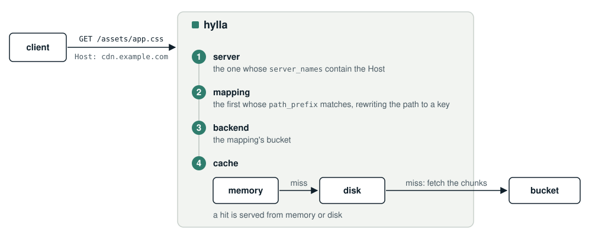

<p align="center">
  <picture>
    <source media="(prefers-color-scheme: dark)" srcset="assets/hylla-mark-dark.svg">
    
  </picture>
</p>

# hylla

A caching HTTP server in front of object storage: S3 and S3 compatible stores, Azure Blob
Storage, or another hylla. Put it between your clients and a bucket to serve objects fast,
fetch each one from the bucket rarely, and keep serving while the bucket is down.

- **A hybrid cache** in memory and on disk, where it survives restarts, of objects in
  chunks, so range requests read only what they need.
- **Fresh by design**: objects are cached by ETag, so a changed object is never served
  stale. Refresh rules check and preload objects in the background, so requests rarely wait
  on the bucket.
- **Routing** by host and path prefix, with regex rewrites from paths to bucket keys.
- **Sites**: frontend builds served per commit, with aliases such as `live` or `pr1873`
  that CI moves without a reload.
- **JWT auth** per mapping, with keys from your OpenID provider, optionally limiting each
  token to keys built from its claims, or **authorization by
  [Konklav](https://github.com/cstruct/konklav)**, down to the object a path names.
- **Clusters** that share their work, so the bucket serves each object once per cluster,
  and **origin shields** for nodes far from the bucket.
- **A control plane** to see how backends are doing and change objects, with sign-in through
  an OpenID provider.
- **Metrics, traces and logs** over OTLP.

> **Note on LLM use:** large parts of this project were written with an LLM, under human
> direction. The design and review are human.

## How it works

<p align="center">
  
</p>

hylla answers `GET` and `HEAD`, with single byte ranges, `If-None-Match` and `If-Match`. It
trusts an object's size and ETag for `metadata_ttl` (30 seconds by default), and checks them
with the backend after that. Its chunks are cached until they're evicted.

## Quickstart

This runs hylla in front of [VersityGW](https://github.com/versity/versitygw), an S3
compatible gateway serving a local directory, so it needs no cloud account. It takes about
five minutes.

1. **Get hylla.** Download it from the
   [releases](https://github.com/cstruct/hylla/releases) and put `hylla` on your `PATH`, or
   build it from this repository:

   ```bash
   cargo install --locked --path crates/server
   ```

2. **Start a local S3** with a bucket named `assets`. Get `versitygw` from its
   [releases](https://github.com/versity/versitygw/releases), then:

   ```bash
   mkdir -p s3/assets
   versitygw --access hylla --secret hylla-secret --port 127.0.0.1:7070 posix ./s3
   ```

3. **Upload an object**, in another terminal. curl can sign S3 requests:

   ```bash
   echo 'body { color: teal }' > app.css
   curl --aws-sigv4 "aws:amz:us-east-1:s3" --user hylla:hylla-secret \
     -T app.css http://127.0.0.1:7070/assets/app.css
   ```

4. **Start hylla** with [examples/minimal](examples/minimal), which serves `localhost:8080`
   from that bucket:

   ```bash
   hylla --config examples/minimal/config.styx --secrets examples/minimal/secrets.styx
   ```

5. **Request the object** through hylla:

   ```bash
   curl -i http://localhost:8080/app.css
   ```

   Stop VersityGW and request it again: hylla still serves it from its cache.

The [minimal config](examples/minimal/config.styx) is all it takes:

```styx
servers {
  local {
    listen 127.0.0.1:8080
    server_names (localhost)
    mappings ({path_prefix /, backend assets})
  }
}
backends {
  assets {
    type s3
    bucket assets
    region us-east-1
    endpoint http://127.0.0.1:7070
  }
}
```

with the credentials in a [secrets file](examples/minimal/secrets.styx), which is the only
place they can come from:

```styx
backends {assets {access_key_id hylla, secret_access_key hylla-secret}}
```

Requests are matched to a server by their `Host` header, so `http://127.0.0.1:8080` answers
`404 unknown host`: that host isn't in `server_names`. To see the config hylla would run
with, and where each value comes from, run `hylla config show` with the same flags.

## Next steps

[examples/](examples) has configs for common setups:

| Example | |
|---|---|
| [cdn](examples/cdn) | A website's assets: rewrites, refresh rules, a disk cache, stale content while S3 is down, health checks and metrics |
| [jwt-tenants](examples/jwt-tenants) | Files per tenant behind JWTs |
| [konklav](examples/konklav) | Objects behind Konklav, deciding who may read each one |
| [control-plane](examples/control-plane) | The web UI and JSON API, with sign-in through Konklav |
| [cluster-kubernetes](examples/cluster-kubernetes) | Three nodes sharing their work in Kubernetes |
| [origin-shield](examples/origin-shield) | Edge nodes reading a bucket through a shield next to it |
| [sites](examples/sites) | Frontend builds per commit, with preview hosts and aliases CI moves |
| [reference](examples/reference) | Most settings in one annotated config |

The [guides](docs/guide) explain hylla in depth:

- [Configuration](docs/guide/configuration.md): files, environment variables and flags, and
  every setting.
- [Running in production](docs/guide/production.md): Docker, sizing, freshness, health
  checks and shutdown.
- [Clustering](docs/guide/clustering.md): clusters, mutual TLS and origin shields.
- [Control plane](docs/guide/control-plane.md): the UI, the JSON API and signing in.
- [Observability](docs/guide/observability.md): metrics, traces and logs.
- [Troubleshooting](docs/guide/troubleshooting.md): what common errors mean.

## Docker

Images for `linux/amd64` and `linux/arm64` are on Docker Hub as
[`cstruct/hylla`](https://hub.docker.com/r/cstruct/hylla):

```bash
docker run --stop-timeout 30 -p 8080:8080 \
  -v ./config.styx:/etc/hylla/config.styx:ro \
  -v ./secrets.styx:/etc/hylla/secrets.styx:ro \
  -v hylla-cache:/var/cache/hylla \
  cstruct/hylla --config /etc/hylla/config.styx --secrets /etc/hylla/secrets.styx
```

See [Running in production](docs/guide/production.md#docker).

## Contributing

[CONTRIBUTING.md](CONTRIBUTING.md) covers building, the tests, the spec, and releasing.
